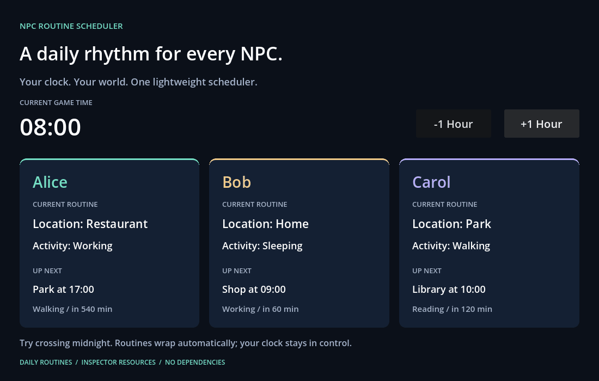
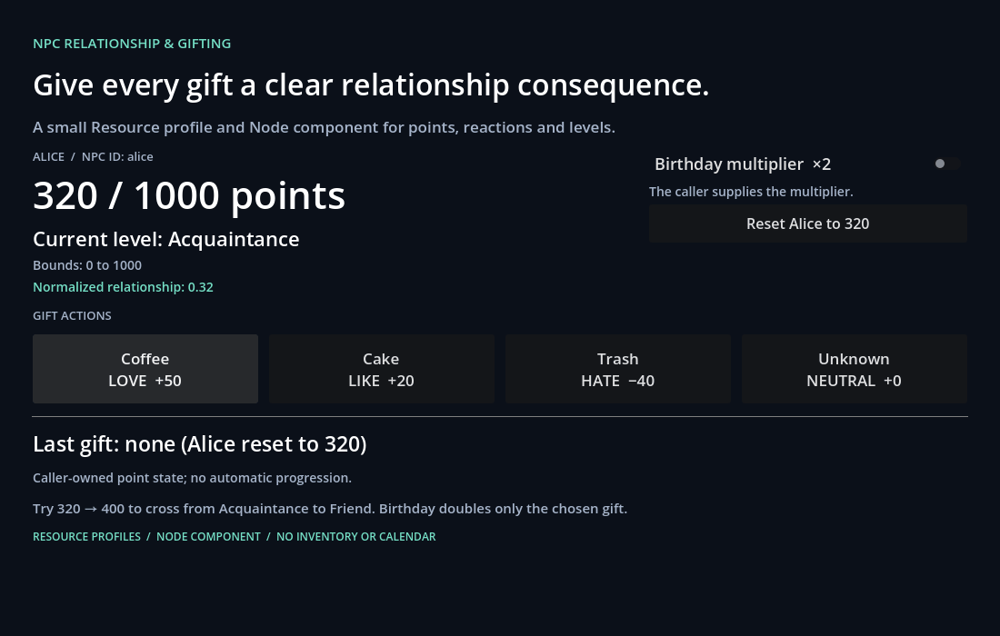
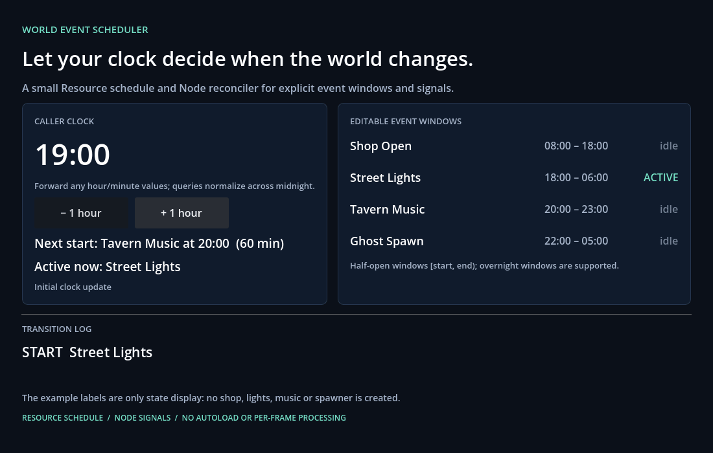
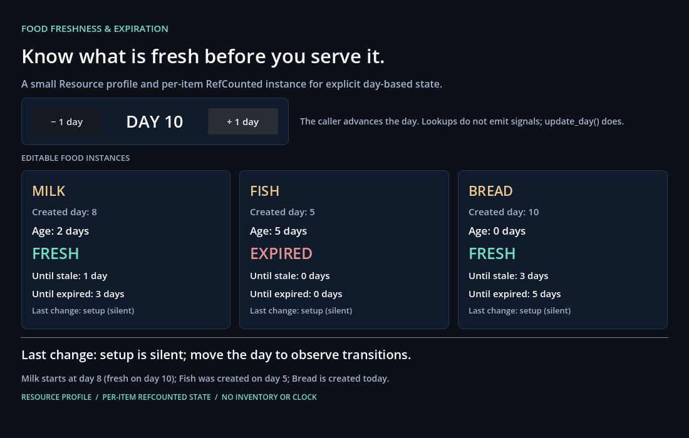
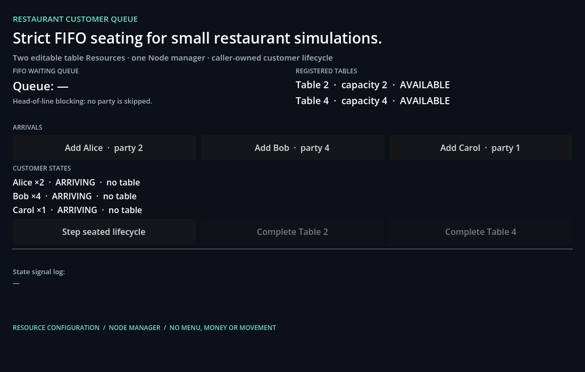

# Godot Simulation Plugins

**Five lightweight, standalone simulation addons for Godot 4. Free and open source under MIT.**

Daily NPC routines, relationships and gifts, world events, food freshness, and restaurant queues—without adopting a whole game framework.

**If these tools help your game, consider giving this repository a Star ⭐.** Stars, donations and accounts are not required to use the code. Bug reports, documentation improvements and small focused contributions are welcome too.

## Choose a plugin

| Plugin / documentation | What it does | itch.io download |
|---|---|---|
| [NPC Routine Scheduler](npc-routine-scheduler/) | Resolve current/next location and activity from your game clock. | [Free / optional donation](https://grgy078033.itch.io/npc-routine-scheduler) |
| [NPC Relationship & Gifting](npc-relationship-gifting/) | Relationship points, levels and gift preferences. | [Free / optional donation](https://grgy078033.itch.io/npc-relationship-gifting) |
| [World Event Scheduler](world-event-scheduler/) | Daily/overnight event windows and start/end signals. | [Free / optional donation](https://grgy078033.itch.io/world-event-scheduler) |
| [Food Freshness & Expiration](food-freshness/) | Day-based fresh, stale and expired states. | [Free / optional donation](https://grgy078033.itch.io/food-freshness) |
| [Restaurant Customer Queue](restaurant-customer-queue/) | Strict FIFO queues, suitable table assignment and customer states. | [Free / optional donation](https://grgy078033.itch.io/restaurant-customer-queue) |

Each folder is a separate runnable Godot project. **Do not import this repository root as a Godot project.** The addons work independently; combining their APIs is your game's responsibility.

## Quick start

1. Download this repository using **Code → Download ZIP**, or clone it:

   ```sh
   git clone https://github.com/grgy078033/godot-simulation-plugins.git
   ```

2. In Godot, import one product's `project.godot`, for example `npc-routine-scheduler/project.godot`.
3. Press **F5** to run that demo.
4. To integrate into an existing game, copy that product's folder from `addons/` into your game's `addons/` directory. Read its README for the API, signals and Inspector setup.

Keep the MIT notice with redistributed copies/substantial portions of the software. A copy of `LICENSE.txt` is included at each product root; when copying only an addon folder, copy the notice with it as well.

No required Autoload, third-party runtime dependency or editor-plugin activation. No movement, navigation, save system, inventory or networking is included.

## See the demos

<details><summary>NPC Routine Scheduler</summary>



</details>

<details><summary>NPC Relationship & Gifting</summary>



</details>

<details><summary>World Event Scheduler</summary>



</details>

<details><summary>Food Freshness & Expiration</summary>



</details>

<details><summary>Restaurant Customer Queue</summary>



</details>

These are actual status-panel demos, not promises of complete game scenes or built-in character movement.

## Compatibility and scope

Tested with **Godot 4.7.2 stable on Windows, Compatibility renderer**. Other versions and platforms are not certified. Typed GDScript and Inspector-friendly Resources are used throughout. The five addons have also passed a basic co-installation smoke test; no built-in cross-plugin gameplay integration is implied.

Version **1.0.1** is the MIT release. Gameplay logic, demo scenes, Resources and project settings are unchanged from the previously validated 1.0.0 source packages. Queue's optional no-op editor entry point was also corrected to extend EditorPlugin. Tests are included for contributors; see [CONTRIBUTING.md](CONTRIBUTING.md).

## License and the move to open source

[MIT License](LICENSE). You may use these plugins in commercial and closed-source games, modify them, and redistribute them subject to retaining the MIT notice. There is no purchase requirement.

These plugins were previously sold under a different license. Earlier transactions and license grants are not revoked; anyone, including previous buyers, may now obtain this MIT release for free. Donations on itch.io are optional and do not unlock extra source code or imply a support contract.

AI-assisted code, documentation and simple graphics were used during development. The demos and tests are available for inspection; please report reproducible issues rather than assuming every integration is covered.

## Feedback and contributions

Open a [GitHub issue](https://github.com/grgy078033/godot-simulation-plugins/issues) with the plugin name, Godot version and a minimal reproduction. Do not include credentials, personal data or unrelated private game files. See [CONTRIBUTING.md](CONTRIBUTING.md) before making changes.

The older [Godot Simulation Systems landing page](https://github.com/grgy078033/godot-simulation-systems) remains a discovery link; this repository is the home for source and contributions.
